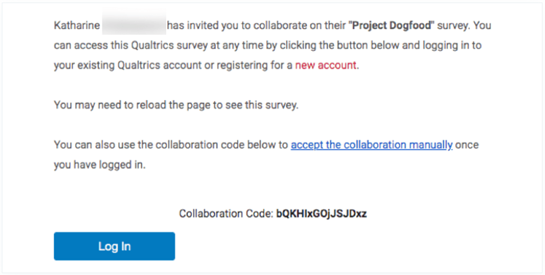
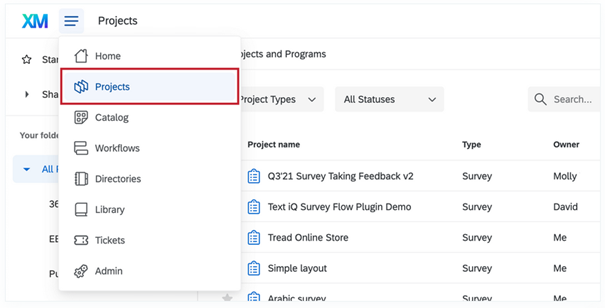
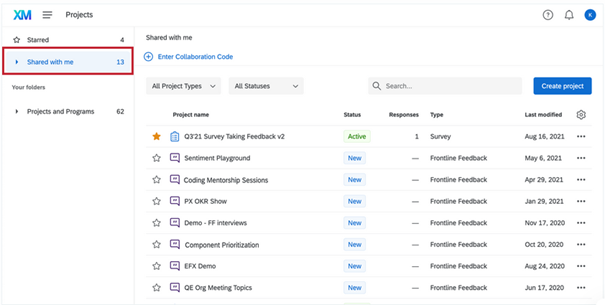
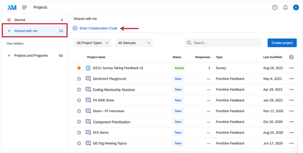
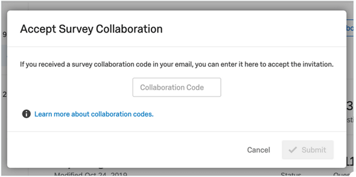
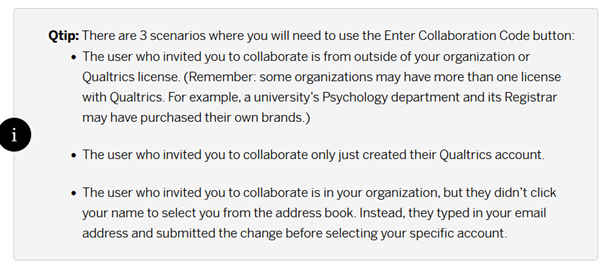
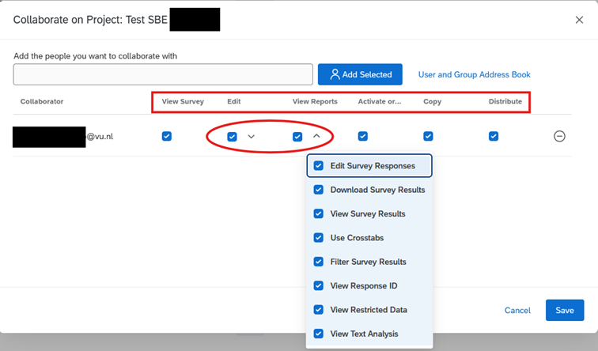

## Advanced Features

Unfortunately, the current Qualtrics subscription does not support (templates) for conjoint surveys/projects (and analysis).

However, there are a number of advanced features available on [vuamsterdam.eu.qualtrics.com](https://vuamsterdam.eu.qualtrics.com), which you may be able to use to reproduce a desired setup. 

Please refer to:

- Embedded Data, which includes options as branching, display logic and piped text.
[Standard Elements, Embedded Data](https://www.qualtrics.com/support/survey-platform/survey-module/survey-flow/standard-elements/embedded-data/)  

- API Support, which can be used on top of embedded data.
[API Integration](https://www.qualtrics.com/support/integrations/api-integration/using-qualtrics-api-documentation/)

- JavaScript. A JavaScript Editor add-on is also available on the Central Brand.
[Question Options, Add Javascript](https://www.qualtrics.com/support/survey-platform/survey-module/question-options/add-javascript/)

- Getting Started with Conjoint, a reference KB article as it might help to elaborate your own survey design within the current brand's limitations.        
[Getting Started with Conjoint Projects](https://www.qualtrics.com/support/conjoint-project/getting-started-conjoints/getting-started-choice-based/getting-started-with-conjoint-projects/#Steps)

## Collaboration on VU’s Central Brand (Named Brand SSO)

Each Qualtrics Brand is seen as a separate Organisation. When sharing surveys between brands, you will be collaborating between Organisations. You will likely also be sharing surveys between different brand types.

### How to: Collaboration Between Different Brand Type

Main Knowledge Base item, [Collaborating on Survey Projects](https://www.qualtrics.com/support/survey-platform/my-projects/sharing-a-project/)

1. If you are collaborating with someone through a SSO brand **from outside of your organisation**, then you may use any email address that collaborator(s) has/have access to. They will receive a secure collaboration code, log in to the Qualtrics account of their choice, and enter the code.

2. When someone invites you to collaborate on a survey, you will receive this invite: 

 

You may ignore the links in the invitation.
Please **do not click on “new account”**. Even if you do not have an account through your organisation yet, do not use this link. Do not click on Log In as this will redirect you to the inviter’s Qualtrics Brand login page. If you still need to create a new account, go to the special URL your organisation has set up for Qualtrics.

3. To access the survey you have been invited to collaborate on, log into your Qualtrics account as you normally would. Then follow the steps in **Accessing Shared Surveys** to gain access to your survey.

4. Once users have been invited to collaborate on a project, the collaborators receive an email notifying them, and they will be able to see it listed in their **Shared with me** folder the next time they log in.

5. To Access This Folder > Navigate to the Projects page.
 

6. Select **Shared with Me**.  

 
7. Enter **collaboration code**.  
 

8. Accept Survey Collaboration by clicking **Submit**  

***Qtip and Last Considerations***
 

> Extended information is also available on [Collaborating with SSO Users](https://www.qualtrics.com/support/survey-platform/my-projects/sharing-a-project/#SSO) and [Accessing Shared Surveys](https://www.qualtrics.com/support/survey-platform/my-projects/sharing-a-project/#AccessingSharedSurveys) if you would like to know more about Collaboration between different brand types. 

### Access Rights

Individual user permission are configurable when using Collaboration features. Please refer to [Collaboration Permissions](https://www.qualtrics.com/support/survey-platform/my-projects/sharing-a-project/#SharingPermissions). Please be aware that by default all rights are granted when collaborating.       

Access rights can be set for Viewing, Editing, View Reports, Activation, Copying and Distributing: 

