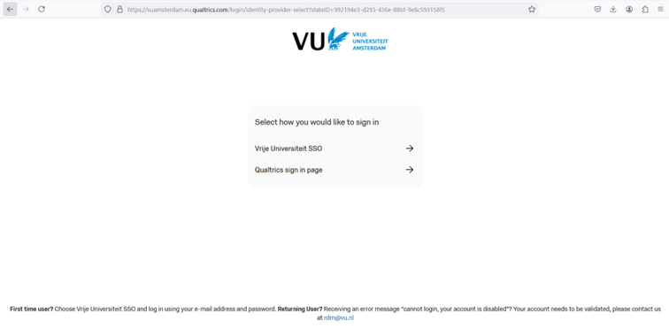
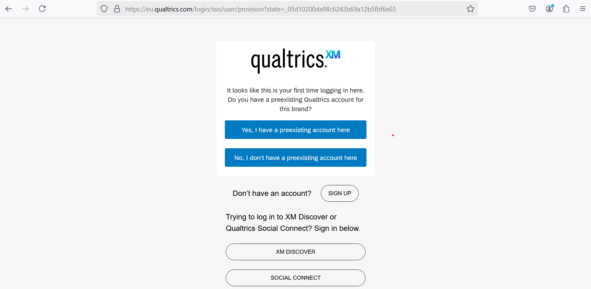
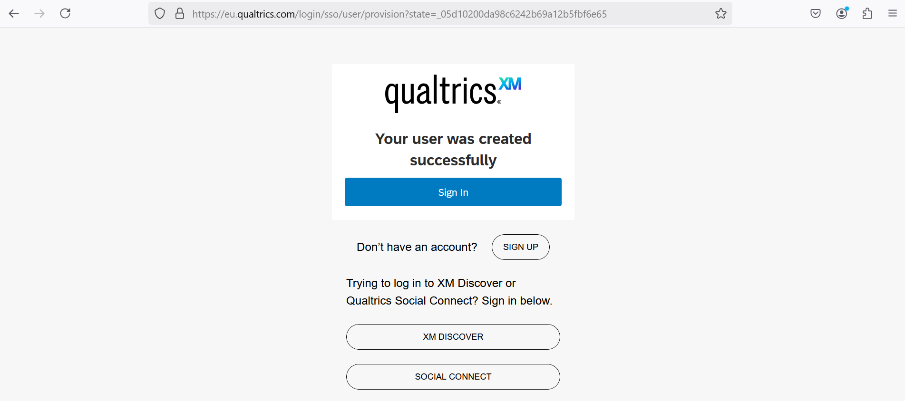
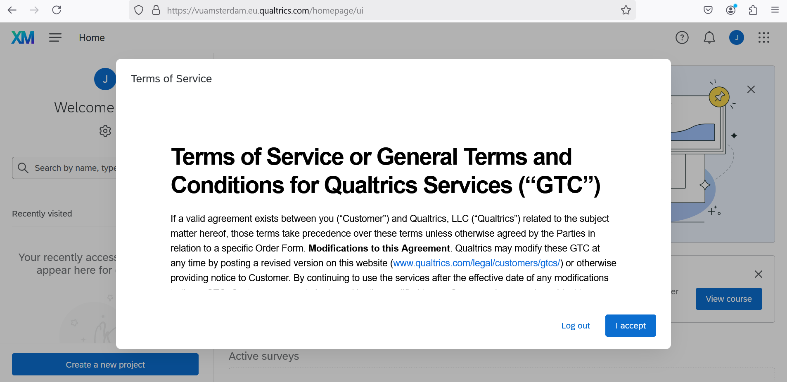

## How to: Create and access your account

1. Go to: [https://vuamsterdam.eu.qualtrics.com](https://vuamsterdam.eu.qualtrics.com)
2. On the login page, choose: Vrije Universiteit SSO
3. Log in with your VU account credentials (email address and password)

    

4. Choose “No, I don’t have a preexisting account here” when it is your first time enrolling the central brand

    

5. Click `Sign In`

    

6. Terms of Service or General Terms and Conditions for Qualtrics Services are presented for review and acceptance. 

    

> It is recommended to save [VU's Central Brand](https://vuamsterdam.eu.qualtrics.com) as a Favourite or Bookmark link for future reference.
