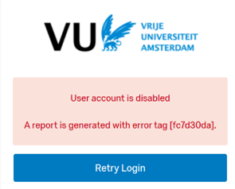

## Login Error Disabled Account

Security settings disable a user's account after a certain amount of inactivity. This threshold is currently 12 months. This setting follows security requirements regarding User Account Management.

A disabled account status does not affect its data.

Users who receive an error when trying to log back in after extended periods of inactivity (`User account is disabled`) can use the [contact form](https://services.vu.nl/esc?id=sc_cat_item&sys_id=7faa1a1fc37b8b1026ed7e43e40131b2) to have their accounts re-enabled.
