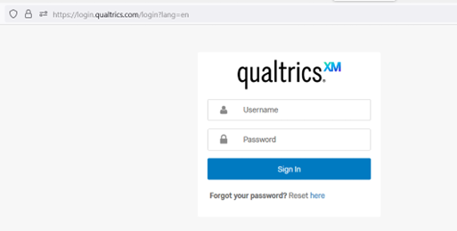
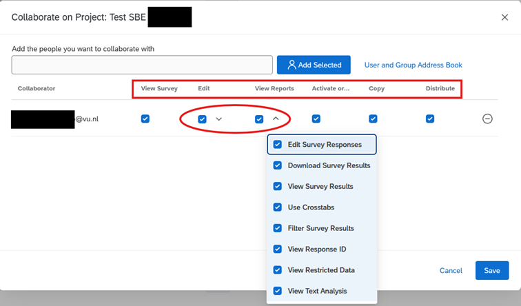

Couldn’t find an answer to your question yet? The [Qualtrics website](https://www.qualtrics.com/support/) provides extensive tutorials and guidance on how to use the platform.

## Login & Account Status

### Question 01

*I cannot login, I received an error message stating that my password is incorrect. I tried to request a password reset but it does not work. How do I access my account?*

Another login method than `Vrije Universiteit SSO` was used. Go to the [login page](https://vuamsterdam.eu.qualtrics.com), choose: `Vrije Universiteit SSO` and log in with your VU account credentials (email address and password). See also the [Creating an Account](create_account.qmd) for more information on creating a new account. 

### Question 02

*I cannot login, I received an error message “account is disabled”. How do I access my account?*

Security settings are in place which set a user's account status to `Status: Disabled` when a certain inactivity threshold has been reached. A disabled account status does not affect its data. Please fill in the [contact form](https://services.vu.nl/esc?id=sc_cat_item&sys_id=7faa1a1fc37b8b1026ed7e43e40131b2) to have your account re-enabled.

### Question 03

*I think I need an account upgrade, how should I do that?*

Licensed functionality on the VU's Central Brand is made equally available to all users. Users should not engage in account upgrades with Qualtrics. This would be deemed an agreement between the user and Qualtrics directly, and falls outside VU’s licence and contract management responsibilities. (Very) high costs will likely be involved in account upgrade requests.

### Question 04 

*A survey template was shared with me by my course supervisor, but I am missing features and functionalities. If I want to use these (additional) functions, I need to upgrade my account, how I can do that?*

A Qualtrics free account is likely been used instead of VU’s Central Brand account. Everyone can create a free account on the Qualtrics main site (The Qualtrics Brand). These free accounts have limited functionality and validity (See also [Question 03](#question-03)). Verify the URL of the account you are logged in to. Proceed to create an account on VU’s Central Brand (See also [Question 01](#question-01))    

Free Account Login Page. URL will look like this: 

### Question 05

*I was using a Qualtrics free account and I have now created an account on VU’s Central Brand. How can I transfer any data I had on my free account to my VU account?*

Qualtrics free accounts do not support the automated transfer of data between brands. The account owner will have to execute a Manual Move. This means downloading data from the free account and uploading this data onto the branded account. The steps to process a Manual Move are outlined in this article: [User Moves – Manual Move](https://www.qualtrics.com/support/survey-platform/managing-your-account/user-moves/#ManualMove).   

## Collaboration - Advanced Settings

### Question 11

*What access rights are available through Collaboration and can I specify what level of access is granted to individual Collaborators?*

Yes, individual user permission are configurable when using Collaboration features. Please refer to [Collaboration Permissions](https://www.qualtrics.com/support/survey-platform/my-projects/sharing-a-project/#SharingPermissions). Please be aware that by default all rights are granted when collaborating.       

Access rights can be set for Viewing, Editing, View Reports, Activation, Copying and Distributing: 

