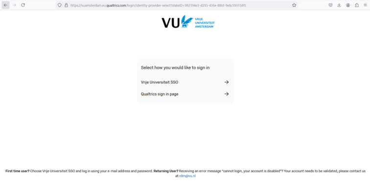
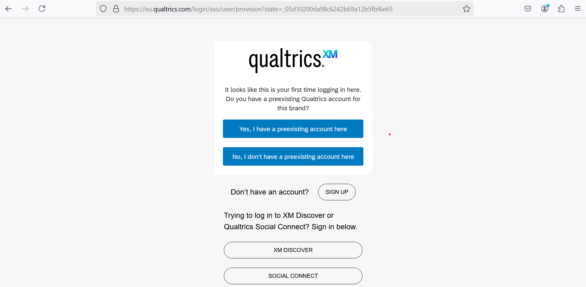
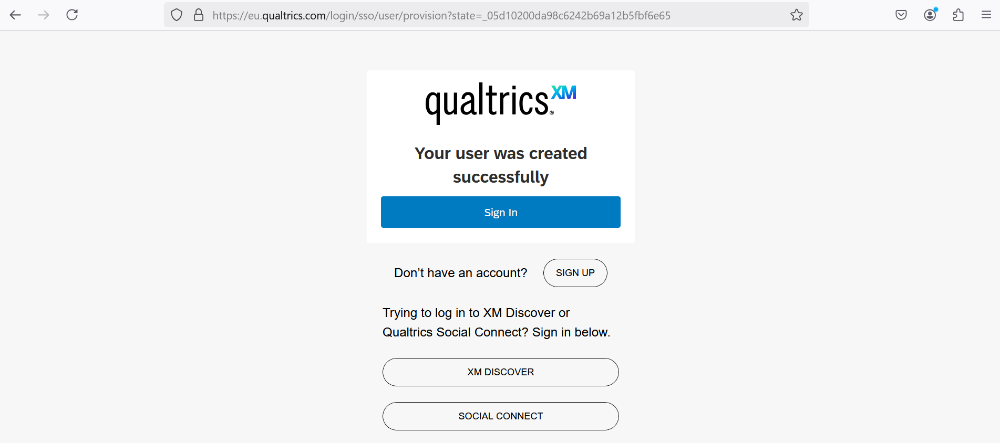
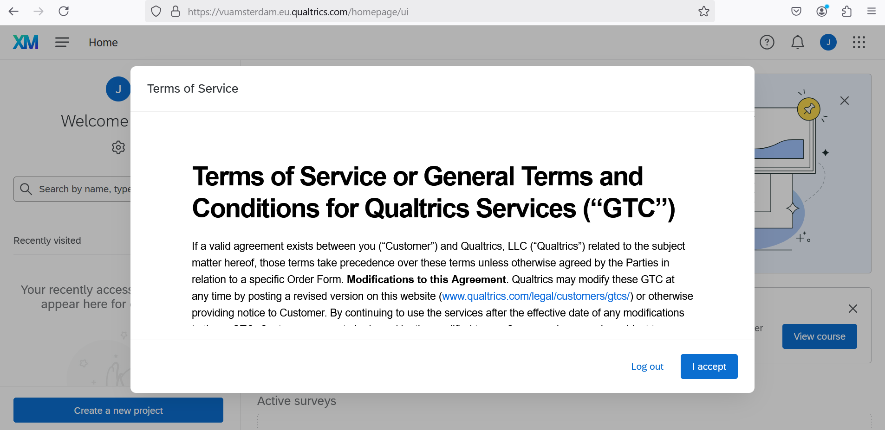
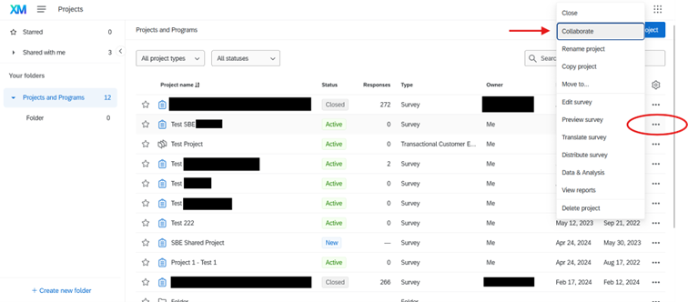
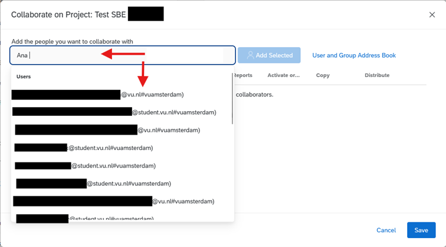
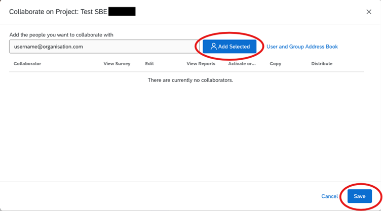

## How to: Create and access your account

1. Go to: [https://vuamsterdam.eu.qualtrics.com](https://vuamsterdam.eu.qualtrics.com)
2. On the login page, choose: Vrije Universiteit SSO
3. Log in with your VU account credentials (email address and password)

    

4. Choose “No, I don’t have a preexisting account here” when it is your first time enrolling the central brand

    

5. Click `Sign In`

    

6. Terms of Service or General Terms and Conditions for Qualtrics Services are presented for review and acceptance. 

    

> It is recommended to save [VU's Central Brand](https://vuamsterdam.eu.qualtrics.com) as a Favourite or Bookmark link for future reference.

## Collaboration - Getting Started

Collaboration features allow you to give other Qualtrics users access to your surveys when they log into their accounts. That way, you can work on the same project without giving out your account information. You can even choose to restrict what type of access other users have to your project. 

Be aware that Qualtrics may offer different experiences depending on which brand type one is sharing from or been invited to join in using Collaboration features. Qualtrics recognizes three main brand types: Free Brand, Named Brand non-SSO and Named Brand SSO. VU’s Central Brand is a Named Brand SSO. 

## How to : Inviting people to collaborate on a project

1. Go to your Projects page and click on settings (…) of the project you want to share. Choose Collaborate. 

Project Page View:

- When collaborating within your organisation, you can look up the person you want to invite via the lookup field. Just start typing the name or email address of the user you want to find. Select the appropriate user.   

2. Lookup field in Collaboration:
 

- If you are inviting someone from outside your organisation, you should type in their email address. Click `Add Selected` and then `Save`. 
Collaboration settings, adding invitation and access rights: 

