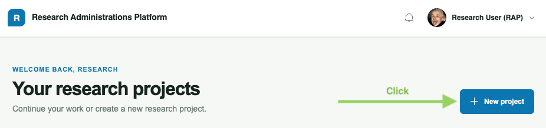
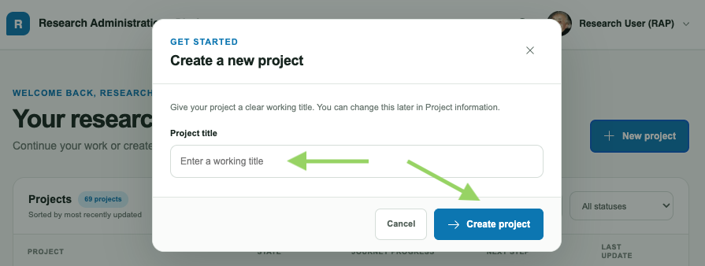
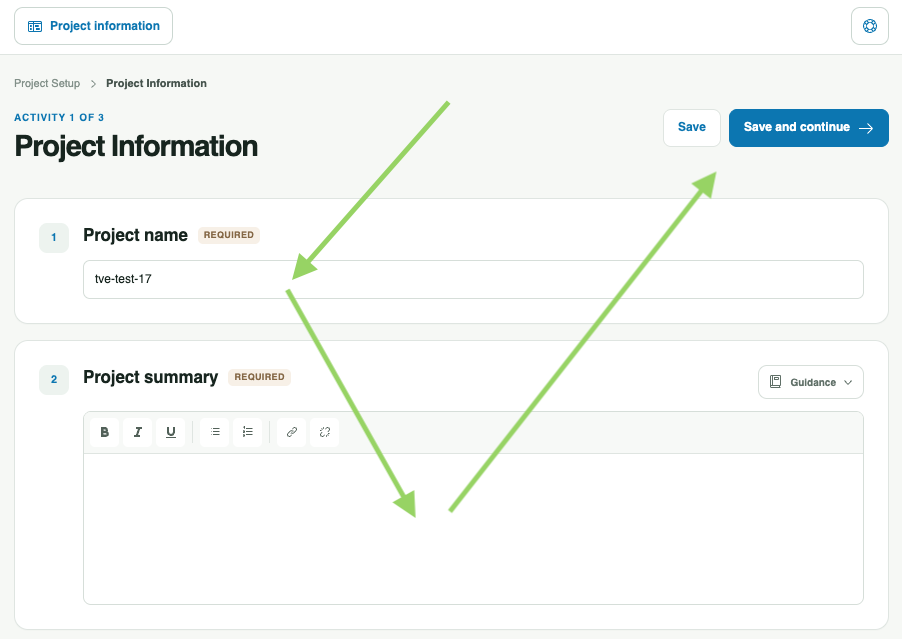
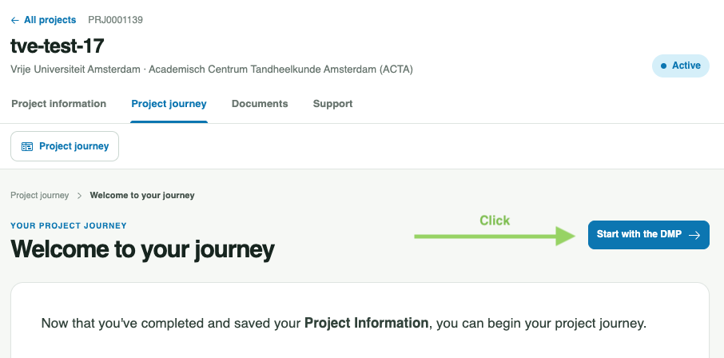

You can find practical manuals in this documentation.

## Access and getting started

Proceed to [RAP](https://services.vu.nl/now/rap)

## Create a new project or select an existing one

Create a new project and describe your research project by filling in the project information.

## Create a project journey

After you have completed the project information, your project journey will be created.

When your project journey is ready, you can start by filling in the forms. It is recommended to start with the DMP and to go through the activities and questions in order.

